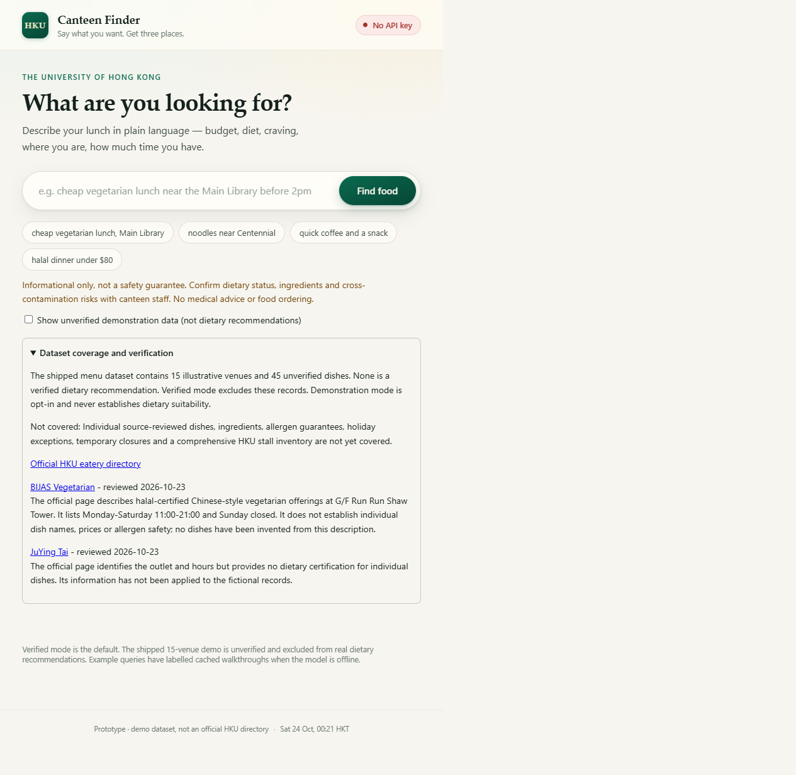
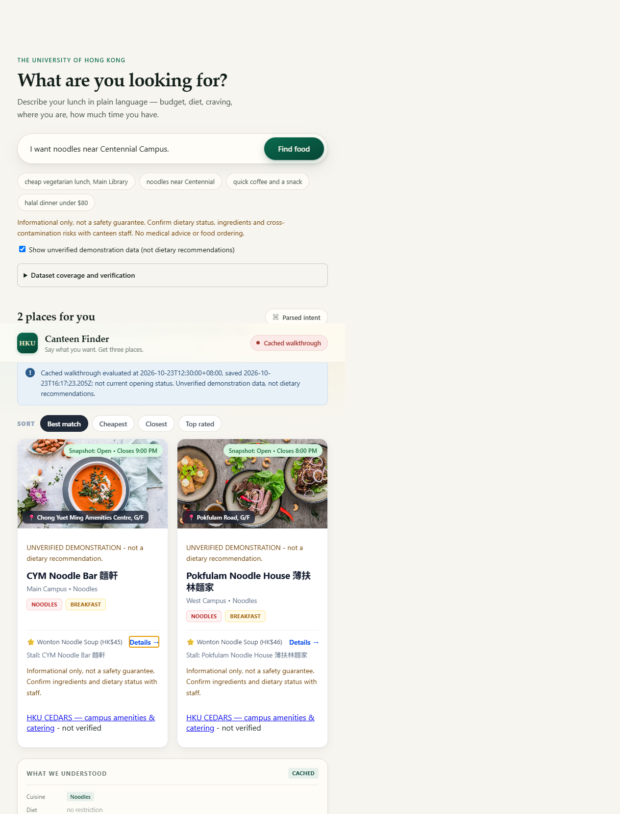

# HKU Campus Dining & Dietary Navigator

A local information-only dining app. It does **not** place or modify orders,
provide medical advice, diagnose allergies or guarantee allergen safety.

**Readiness: not ready for real dietary recommendations.** The shipped dataset
has 15 illustrative venues and 45 unverified menu items, not 50 source-reviewed
items. Verified mode excludes them. An empty answer means **"No match found in
the current dataset"**, not that suitable food does not exist on campus.

Informational only, not a safety guarantee. Confirm dietary status, ingredients
and cross-contamination risks with canteen staff. An absent ingredient is not
evidence of safety.

## Three-step first use (packaged release)

1. **Unzip** the release folder matching your OS and architecture. Keep its
   `runtime`, `data`, `public` and `server` folders together.
2. **Open the launcher:** double-click `run.bat` on Windows, or `run.command` on
   macOS (Finder runs `.command` files in Terminal, which is the reliable path
   on a Mac). On Linux run `sh run.sh` in a terminal. The release includes Node,
   so no Python or Node installation is required. Windows is the only launch
   path verified end to end; macOS and Linux still need platform testing.
   If a launcher reports "permission denied", the archive lost the executable
   bit — run `chmod +x run.sh run.command` once, or start it with `sh run.sh`.
3. **Use the browser** at <http://127.0.0.1:4173>. Keep the launcher window open.
   Try a sample query. Without an API key, exact sample queries use prominently
   labelled cached walkthroughs, not current opening status.



To see illustrative cards, explicitly select **Show unverified demonstration
data**, then select the noodles example. Dietary searches still exclude
unverified dishes, even in demonstration mode.



For live parsing, copy `.env.example` to `.env` with a text editor and insert
your existing Week 2 DeepSeek key as `BAILIAN_API_KEY`. The key stays on the
local server; it is never included in a release folder or browser response.
Never put a key in a query or commit `.env`.

## Source checkout / developer setup

Requires **Node.js 22.16 or newer** (`node:sqlite` is not available in Node 18).
There are no npm dependencies and no build step.

```sh
npm start
npm test
npm run migrate
npm run evaluate
npm run evaluate -- --live
npm run cache:walkthrough
npm run package
```

- `npm start`: starts on port 4173, loopback only. `PORT` overrides it. Avoid
  5000 and 7000 on macOS, where AirPlay Receiver holds both.
- `npm test`: scoped regression tests, including HTTP, launcher lifecycle and a
  local fake model provider. No external provider calls. The explicit test glob
  prevents copied release tests from being discovered a second time.
- `npm run migrate`: validates schema, data import and database integrity.
- `npm run evaluate`: executes local safety cases; marks model-dependent
  cases blocked and exits nonzero while acceptance requirements remain unmet.
- `npm run evaluate -- --live`: makes real model calls using the configured
  key (may incur cost), disables cached answers and writes a report.
- `npm run cache:walkthrough`: regenerates eight snapshots (four example
  queries in verified and demo modes), using Friday 23 October 2026 at 12:30
  HKT as the explicit walkthrough clock. These are authored walkthroughs,
  not captured successful live-model answers. Actual save time is separate.
- `npm run package`: creates `dist/hku-food-<platform>-<architecture>` with
  the running Node binary and its LICENSE. Use an official Node distribution
  with LICENSE beside the executable. Zip the output folder for distribution.
  Build separately on each target OS; a Windows runtime cannot run on macOS.
  Existing output directories are not overwritten.
  To create another release without touching the existing one, use
  `npm run package -- dist/hku-food-validated`.

`run.bat` and `run.sh` can also use an installed runtime in a source checkout.
A source checkout without Node is not a self-contained release.

### Provider configuration

```dotenv
PORT=4173
BAILIAN_API_KEY=
BAILIAN_BASE_URL=https://api.deepseek.com/v1
BAILIAN_MODEL=deepseek-chat
LLM_TIMEOUT_MS=12000
```

The `BAILIAN_*` variable names are retained for compatibility. Existing
OpenAI-compatible providers remain supported; set their base URL and model
together. `npm run check-key` makes a real diagnostic provider call.

## Pipeline and safety contract

```text
query
  -> local ordering / medical / allergen guard
  -> model parses intent (English or Chinese)
  -> validate known values; preserve unsupported requirements
  -> restore explicitly stated dietary requirements
  -> verified item retrieval + strict time / location / budget filtering
  -> rank qualifying venues; return only qualifying menu items
  -> cards with stall, sources, check dates and safety disclaimer
```

The model never supplies menu records, prices or hours. Recommendations come
from local JSON projected into SQLite. Unknown diets and locations are retained
as unsupported constraints, not silently broadened. Multiple diets must hold
on the **same item**. Hard constraints, particularly dietary restrictions, are
never relaxed.

All requested diets are preserved, including four simultaneous restrictions.
Malformed constraint types fail validation. Dietary terms in the cuisine field
also activate dietary checks. Decimal budgets are never rounded upward.
Cuisine filtering selects individual dishes, not other items sold by the same
food court. Cheapest ordering uses the lowest matching dish price; the API's
legacy `avgPrice` field now carries this matching-item price for compatibility.
Unknown prices cannot satisfy a hard budget and sort after known prices.
A walking limit without a starting landmark is reported as unsupported.

Explicit eating times are checked even when `open_now` is false; closing time
is exclusive. "After 8 PM" is evaluated at 20:00, not as an all-evening
availability promise. Unsupported future dates and ranges must be reported
as unsupported by the parser. Distances remain straight-line estimates
multiplied by 1.35, not accessible walking-route guarantees.
Meal-only queries require schedule overlap with the documented interpretation:
breakfast 07:00-11:00, lunch 11:00-15:00, dinner 17:00-22:00, and snack at any
opening time. An explicit time takes precedence. These are query interpretation
windows, not evidence that a particular dish is served throughout that window.

Safety refusals run before the model and work offline. They are conservative
English/Chinese pattern rules plus a model refusal field, not a clinically
validated language classifier. Unusual paraphrases still need broader testing.
No safety claim should be inferred from any result.

If the model is unavailable, an exact example query may use a cached snapshot
only when its dataset hash and safety-policy version match. It is prominently labelled with the
walkthrough clock and save date. Other queries return `503 model_offline`.
Explicit test-time overrides disable cached answers.

## Data and evidence schema

Source of truth:

- `data/canteens.json`: venues, hours and menu items.
- `data/vocab.json`: permitted cuisines, diets and facets.
- `data/coverage.json`: reviewed official pages and known omissions.
- `data/walkthrough.json`: labelled example snapshots.

Each venue has `verified: boolean` and dated `sources` supporting its identity
and hours. Each menu item has:

| Field | Meaning |
|---|---|
| `name`, `price` | Source-supported dish and HKD price, or `null` when price is unknown; do not invent a price |
| `stall` | Actual stall identity within its parent venue |
| `cuisines` | Item-level cuisine categories; demonstration categories are not dietary evidence |
| `verified` | Item and its source were reviewed, not inferred |
| `is_certified_halal` | `true`, `false`, or `null` for unknown |
| `is_vegetarian` | `true`, `false`, or `null` for unknown |
| `ingredients_listed` | Source-listed strings or `null` for unknown |
| `dietary_tags` | Additional explicitly supported tags, e.g. vegan |
| `dietary_tags_source` | Evidence objects with `tag`, `statement`, `label`, HTTPS `url`, and `checkedAt` |
| `sources` | Dish/price evidence with `label`, HTTPS `url`, and `checkedAt` (`YYYY-MM-DD`) |

Every positive dietary claim requires explicit evidence. Unverified items
cannot carry positive claims. A `null` value means unknown, not false or safe.
Allergen requests are refused rather than treating a "nut-free" tag as proof
against cross-contamination.

Venue ratings, average prices, price tiers and images may also be explicitly
unknown (`null`). A real outlet must not be assigned invented ratings or prices
just to fit a demo schema. Source URLs must parse as HTTPS URLs, dates must be
real calendar dates no later than today, and dietary tags cannot contradict
their corresponding boolean fields.

### Curation procedure

1. Review a current official outlet/menu source, including the actual stall,
   dish, price, hours and any explicitly stated dietary certification.
2. Record precise source URLs and the real review date. Do not use a general
   homepage as evidence for a particular dish.
3. Record dietary evidence at the item level. Outlet-level certification must
   not be applied to an individual dish without checking its actual scope.
4. Mark the venue and item verified only after that review. Unknown ingredients
   remain null; do not infer safety from names, cuisine or missing ingredients.
5. Restart, run migration checks and regenerate walkthrough snapshots.
6. Recheck source changes and temporary closures before relying on results.
   A schema-valid source object is not automated proof that its claims are true.

Official pages reviewed on 23 October 2026:

- [BIJAS Vegetarian](https://catering.hku.hk/en/eateries/CCOutletD/):
  outlet-level halal-certified vegetarian offerings and opening hours.
- [JuYing Tai](https://catering.hku.hk/en/eateries/FSCACR/):
  outlet identity, offerings and opening hours.

These pages do not establish 50 individually verified dishes with prices and
dietary evidence. Their findings are listed in coverage; they have **not** been
used to relabel fictional records as real.

The database `data/canteens.db` is generated and gitignored. Schema version and
content hash trigger reimport; search logs are preserved. Item evidence is
stored alongside the existing normalised venue relationships, and older schemas
are automatically upgraded on startup.
`DB_PATH=:memory:` is suitable for isolated tests. Schema 5 includes item cuisines
and nullable prices/presentation metadata. Migration checks compare every menu
item and every day's hours with the JSON, not one hard-coded fictional venue.

## Evaluation and acceptance

The fixed benchmark is `tests/cases.json`:

| Group | Queries | Required |
|---|---:|---:|
| Dietary, including safe handling of nut-free requests | 15 | At least 12 pass |
| Time and location | 10 | At least 8 pass |
| Refusal / unknown stall | 5 | All 5 pass |

The evaluator uses an explicit Friday 12:30 HKT clock for reproducibility,
records expected constraints and full responses, and writes
`reports/evaluation.json` (gitignored). Positive cases require nonempty,
verified item results. Empty results do not count as positive-query success.
Each returned dish must exactly match a stored item of the cited canteen,
including its stall and evidence. Returned venue identity, source links, hours
and walking origin/distance are checked independently of the ranking function.
Refusals require the correct reason, no results, an explanation and the safety
disclaimer. Negative fixtures confirm that invented dishes or altered evidence
cannot pass evaluation. Source truth must also be
manually checked against the cited pages; the evaluator checks metadata and
retrieval behaviour, not remote-page factual accuracy.

The proposal's 50 reviewed-item milestone is tracked separately and also
required before the report marks the project ready. Synthetic unit-test data
does not count toward that milestone or the live-model accuracy threshold.

**Current acceptance blockers:** zero verified menu items, live-model accuracy
not yet measured, Pi Agent verification not yet performed, and macOS/Linux
launch behaviour not yet tested. Passing unit or migration tests does not
remove those blockers.

### Validation performed on 24 October 2026

Regression coverage includes malformed model output, preserving all dietary
restrictions, item-level cuisine/diet matching, decimal budgets, unknown
prices, future-time filtering, data round trips, refusal responses, HTTP errors,
cached-mode labelling, a local fake model endpoint, and launcher lifecycle.
Launcher tests check that an occupied port is not mistaken for a successful
startup and that closing the launcher stops its child server. No live model
accuracy or real menu completeness is claimed by these tests.

## API

- `POST /api/recommend`: `{ "query": "...", "demo": false, "at": "12:30" }`.
  `at` is an optional test-time override for today's HK day.
- `GET /api/coverage`: what is and is not covered, plus official source links.
- `GET /api/health`: runtime model configuration and HK clock (never the key).
- `GET /api/vocab`: vocabulary for the UI.
- `GET /api/canteens`: illustrative venue summaries for opt-in browsing.
- `GET /api/stats`: local query counts and recent queries.

Responses include `reason`, `notice`, `disclaimer`, `coverage`, `mode`, `intent`,
`results` and `meta`. Modes are `local` (guard), `live` or `cached`. Refusal
reasons are `allergen_refused`, `medical_refused`, `ordering_refused`.
Other empty outcomes are `no_match` and `no_preferences`.

Queries are sent to the configured model provider and logged in the local
database. Do not enter private medical or identifying information. API calls
are external; **retrieval itself** uses only the local dataset.

## Agent skill

The reusable skill is [.github/skills/campus-dining/SKILL.md](.github/skills/campus-dining/SKILL.md).
It uses the same API and safety rules. Its Pi Agent verification procedure is
included, but no Pi Agent validation is claimed.

## Agreed proposal changes and limitations

- **Node.js retained instead of Python**, agreed during implementation.
- Local structured data is projected into SQLite; no external menu API is
  used at query time. Model parsing still uses the configured provider.
- The default port is now 4173, because macOS AirPlay Receiver reserves 5000 and
  7000. The default provider is DeepSeek.
- Interactive cards and source links are implemented. Chinese cases are
  included in the benchmark; end-to-end Chinese accuracy is unverified.
- No holiday calendar, dynamic closures, real walking routes, comprehensive
  stall coverage, ordering, diagnosis or allergen guarantees.
- Photos, prices, ratings and names in demo mode remain illustrative.
- This is a local, single-process application with in-memory rate limiting,
  not a deployed multiuser service.
